# BloomHeal 🌿

> **Where Wellness Begins** — A Decentralized Healthcare Ecosystem & AI Medical Intelligence Platform.

[](https://nodejs.org/)
[](https://react.dev/)
[](https://fastapi.tiangolo.com/)
[](https://python.org/)
[](https://wagmi.sh/)
[](https://soliditylang.org/)
[](https://ai.google.dev/)
[](https://www.mongodb.com/)

---

## 📋 Table of Contents
- [Overview](#-overview)
- [System Architecture](#-system-architecture)
- [Key Features](#-key-features)
- [User Roles & Workflows](#-user-roles--workflows)
- [Project Structure](#-project-structure)
- [Tech Stack](#-tech-stack)
- [Prerequisites](#-prerequisites)
- [Environment Configuration](#-environment-configuration)
- [Installation & Quickstart](#-installation--quickstart)
  - [1. Database Setup](#1-database-setup)
  - [2. Core Backend](#2-core-backend-service)
  - [3. Blockchain Backend](#3-blockchain-backend-service)
  - [4. AI Medical Backend](#4-ai-medical-backend-service)
  - [5. Frontend Client](#5-frontend-web-application)
- [API Reference](#-api-reference)
- [Smart Contract Information](#-smart-contract-information)
- [Contributing & License](#-contributing--license)

---

## 🌟 Overview

**BloomHeal** is an integrated next-generation healthcare platform that addresses critical communication silos and data transparency issues in modern medicine. By linking active medical practitioners, registered NGOs, volunteer health workers, and patient communities within a unified framework, BloomHeal provides:

1. **Seamless Healthcare Delivery**: Role-based access control, appointment booking, queue status tracking, and live telehealth chats.
2. **Decentralized Outbreak Intelligence**: Immutable, community-reported epidemic and disease outbreak logging verified on Ethereum testnets.
3. **Medical Camps & Social Impact**: Decentralized coordination of community blood drives, health checkups, and vaccination campaigns with tokenized participant rewards.
4. **AI-Powered Medical Guidance**: Clinical ReAct assistant powered by **Google Gemini 2.5 Flash**, **FAISS Vector RAG**, and **Tavily Web Search** for real-time, evidence-backed medical information and source citations.

---

## 🏗 System Architecture

```mermaid
flowchart TD
    subgraph Client["Frontend Client (Vite + React 18 + TailwindCSS)"]
        UI["Modern Web Application"]
        Wallet["ConnectKit / Wagmi Web3 Provider"]
        WSClient["Socket.io Client"]
    end

    subgraph CoreBackend["Core Backend (Node.js + Express)"]
        Auth["JWT Auth & Role Controller"]
        Appointments["Appointment Engine"]
        ChatHub["Socket.io Real-Time Telehealth Hub"]
        ProfileService["Profiles & Directory Services"]
    end

    subgraph Web3Backend["Blockchain Backend (Node.js + Ethers.js)"]
        OutbreakRouter["Disease Outbreak Service"]
        CampService["Medical Camp & Event Manager"]
        RewardDistributor["ERC-20 Token Allocator"]
    end

    subgraph AIBackend["AI Clinical Backend (FastAPI + Python)"]
        ReActAgent["LangGraph ReAct Agent"]
        GeminiLLM["Google Gemini 2.5 Flash"]
        FAISS["FAISS Vector Store (Local Medical RAG)"]
        Tavily["Tavily Live Web Search Tool"]
    end

    subgraph Blockchain["Ethereum Sepolia Testnet"]
        TokenContract["ERC-20 Reward Token"]
        OutbreakContract["Outbreak Record Smart Contract"]
    end

    subgraph DB["Database Layer"]
        MongoDB[("MongoDB (Collections: users, appointments, camps, chats)")]
    end

    UI -->|REST API| CoreBackend
    UI -->|REST API & Uploads| Web3Backend
    UI -->|Medical Queries| AIBackend
    Wallet -->|Direct RPC / Transactions| Blockchain
    WSClient <-->|Live Consultation Messages| ChatHub

    CoreBackend --> MongoDB
    Web3Backend --> MongoDB
    Web3Backend -->|Contract Calls| Blockchain
    AIBackend --> MongoDB
    ReActAgent --> GeminiLLM
    ReActAgent --> FAISS
    ReActAgent --> Tavily
```



---

## ✨ Key Features

### 1. 🏥 Telehealth & Appointment Pipeline
- **Doctor Discovery**: Search and filter certified medical practitioners by specialization, availability, and qualifications.
- **Appointment Lifecycle**: Patients request appointments; doctors review incoming pending queues, approve or reschedule, and conduct consultations.
- **Real-Time Telehealth Chat**: End-to-end synchronized chat powered by Socket.io, tied directly to verified appointment rooms.

### 2. 🌍 Decentralized Disease Outbreak Reporting
- **Community Alert System**: Registered users and health workers report local disease vectors with symptoms, severity, location coordinates, and photographic evidence.
- **On-Chain Verifiability**: Outbreak submissions are committed to Ethereum smart contracts, preventing data suppression and providing transparent health surveillance.

### 3. ⛺ Community Health Camps & Blood Drives
- **Event Organizing**: NGOs and healthcare institutions schedule blood donation camps, free health checks, and vaccination campaigns.
- **Participant Registration**: Patients and volunteers can discover events, register as participants, and log attendance.

### 4. 🪙 Web3 Tokenomics & Rewards
- **Incentivized Healthcare**: Community members and health workers earn ERC-20 utility tokens for verified camp participation, blood donations, and local health reporting.
- **Non-Custodial Wallet Integration**: Connect via MetaMask, WalletConnect, Coinbase, or any EVM-compatible wallet using ConnectKit and Wagmi.
- **Rewards Claiming**: Directly interact with deployed smart contracts to check token balances and claim synchronized reward pools.

### 5. 🤖 BloomHeal AI Medical Assistant
- **Evidence-Aware Medical AI**: ReAct architecture using LangGraph and Google Gemini 2.5 Flash.
- **Retrieval-Augmented Generation (RAG)**: Custom FAISS vector store indexing medical condition guides, clinical advice, and emergency protocols.
- **Live Scientific Web Search**: Integrated Tavily search tool for the latest public health warnings and clinical trials.
- **Transparent Citations**: Markdown responses dynamically link verified source materials and clinical references.

---

## 👥 User Roles & Workflows

| Role | Permissions & Capabilities |
| :--- | :--- |
| **Patient** | Search doctors, book consultations, access real-time chat, report outbreaks, register for health camps, claim tokens, and query the AI assistant. |
| **Doctor** | Manage clinical schedules, review pending appointment requests, update patient records, and conduct live consultation sessions. |
| **Health Worker** | Validate grassroots field data, coordinate mobile clinic vectors, log camp attendees, and monitor regional epidemic indicators. |
| **NGO** | Organize medical camps and blood donation drives, manage volunteers, track donor records, and publish healthcare updates. |

---

## 📂 Project Structure

```plaintext
WellNest/
├── ai_backend/                 # Python FastAPI AI medical assistant service
│   ├── app/
│   │   ├── agent.py            # LangGraph ReAct agent & Gemini configuration
│   │   ├── config.py           # Environment, RAG & LLM parameters
│   │   ├── db.py               # MongoDB connection for conversation memory
│   │   ├── main.py             # FastAPI entrypoint
│   │   ├── memory.py           # Multi-turn memory & summarization
│   │   ├── rag.py              # FAISS embedding indexer & retriever
│   │   ├── routes.py           # /chat and /health endpoints
│   │   ├── schemas.py          # Pydantic request/response models
│   │   └── tools/              # Tavily web search & Gemini utilities
│   ├── data/                   # Clinical guideline texts for RAG embeddings
│   ├── vectorstore/            # Serialized FAISS index & metadata cache
│   └── requirements.txt        # Python package dependencies
│
├── backend/                    # Core REST API & WebSocket server
│   ├── src/
│   │   ├── app.js              # Express app setup & route mounting
│   │   ├── socket.js           # Socket.io chat room logic
│   │   ├── config/             # MongoDB database connection
│   │   ├── controllers/        # Auth, appointment, doctor, patient controllers
│   │   ├── middlewares/        # JWT verification, RBAC, error handlers
│   │   ├── models/             # Mongoose schemas (User, Appointment, Chat, etc.)
│   │   ├── routes/             # Express API route declarations
│   │   └── utils/              # JWT and cryptographic utilities
│   └── package.json            # Node.js dependencies
│
├── blockchain_backend/         # Web3 gateway & smart contract service
│   ├── contractService/        # Ethers.js contract wrappers & ABIs
│   ├── model/                  # Mongoose models for camps, donors, outbreaks
│   ├── routes/                 # Camp, donation, token reward, outbreak endpoints
│   ├── index.js                # Express Web3 service entrypoint
│   └── package.json            # Node.js dependencies
│
├── frontend/                   # React 18 single-page application (Vite)
│   ├── src/
│   │   ├── assets/             # SVG icons and visual assets
│   │   ├── components/         # Shared UI components (Navbar, Protected routes)
│   │   ├── config/             # Wagmi Web3 configuration & Socket.io client
│   │   ├── pages/
│   │   │   ├── dashboards/     # Landing page, unified dashboard
│   │   │   ├── doctors/        # Doctor list, appointment queues
│   │   │   ├── patients/       # Patient appointments & management
│   │   │   ├── chat/           # Live appointment chat room
│   │   │   ├── events/         # Medical camp organization & participant registration
│   │   │   ├── outbreak/       # Outbreak reporting & visualization
│   │   │   ├── medical_agent/  # AI clinical assistant chat interface
│   │   │   ├── ngo/            # NGO directory
│   │   │   ├── health_workers/ # Health workers directory
│   │   │   ├── users/          # SignUp, SignIn, Web3 Profile & Token Claim
│   │   │   └── blogs/          # Health blogs & community posts
│   │   ├── App.jsx             # React Router routing tree & Web3 providers
│   │   └── main.jsx            # React root mount
│   ├── index.html              # HTML shell
│   ├── vite.config.js          # Vite build config with Tailwind CSS v4
│   └── package.json            # Frontend npm dependencies
│
├── smart-contracts/            # Hardhat smart contracts (Sepolia)
│   ├── token-contract/         # ERC-20 BloomHeal reward token contracts & tests
│   └── outbreak-contract/      # Outbreak registry smart contracts
│
├── prescription_analyzer/      # Experimental OCR/LLM prescription analysis
├── webrtc_trial/               # WebRTC video consultation proof-of-concept
└── README.md                   # Platform documentation
```

---

## 🛠 Tech Stack

| Domain | Technologies |
| :--- | :--- |
| **Frontend** | React 18, Vite, Tailwind CSS (v4), Lucide React, React Router v7 |
| **Web3 & Wallet** | Wagmi, ConnectKit, Ethers.js (v6), Hardhat, Solidity |
| **Core Backend** | Node.js, Express, MongoDB, Mongoose, Socket.io, JWT |
| **Blockchain Gateway** | Node.js, Express, Ethers.js, Multer |
| **AI & NLP** | Python 3.10+, FastAPI, Google Gemini 2.5 Flash, LangGraph, LangChain, FAISS, Tavily API |

---

## ⚙ Prerequisites

Before running the BloomHeal platform locally, ensure you have installed:
- **Node.js** (v18.0.0 or higher) & **npm**
- **Python** (v3.10 or higher) & **pip**
- **MongoDB** (v6.0 or higher running locally or a MongoDB Atlas URI)
- **Git**
- A modern web browser with a Web3 wallet extension (e.g. **MetaMask**)

---

## 🔐 Environment Configuration

Create `.env` files in each service directory according to the templates below:

### 1. `backend/.env`
```env
PORT=5000
MONGODB_URI=mongodb://localhost:27017/bloomHeal
JWT_ACCESS_SECRET=your_jwt_access_secret_key_here
JWT_REFRESH_SECRET=your_jwt_refresh_secret_key_here
JWT_ACCESS_EXPIRES=30h
JWT_REFRESH_EXPIRES=30d
CLIENT_ORIGIN=http://localhost:5173
FRONTEND_URL=http://localhost:5173
SESSION_SECRET=your_session_secret
GOOGLE_CLIENT_ID=your_google_oauth_client_id
GOOGLE_CLIENT_SECRET=your_google_oauth_client_secret
GOOGLE_REDIRECT_URI=http://localhost:5000/api/google/callback
GOOGLE_TOKEN_ENCRYPTION_KEY=64_hex_characters_for_a_32_byte_key
```

Add the Google callback URL to the OAuth client’s authorized redirect URIs.
Generate `GOOGLE_TOKEN_ENCRYPTION_KEY` as 32 random bytes encoded in hex.

### 2. `blockchain_backend/.env`
```env
PORT=7000
MONGODB_URI=mongodb://localhost:27017/bloomHeal
PRIVATE_KEY=your_sepolia_wallet_private_key
SEPOLIA_RPC_URL=https://eth-sepolia.g.alchemy.com/v2/YOUR_ALCHEMY_KEY
MAINNET_RPC_URL=https://eth-mainnet.g.alchemy.com/v2/YOUR_ALCHEMY_KEY
ETHERSCAN_API_KEY=YOUR_ETHERSCAN_KEY
JWT_SECRET=your_jwt_secret_key_here
```

### 3. `ai_backend/.env`
```env
GEMINI_API_KEY=your_google_gemini_api_key
TAVILY_API_KEY=your_tavily_search_api_key
MONGO_URI=mongodb://localhost:27017
```

### 4. `frontend/.env` (Optional)
```env
VITE_WALLETCONNECT_PROJECT_ID=your_walletconnect_cloud_project_id
```

---

## 🚀 Installation & Quickstart

Follow these steps to launch the entire BloomHeal platform:

### 1. Database Setup
Start your local MongoDB instance (default port `27017`):
```bash
# Windows (PowerShell with MongoDB Service)
net start MongoDB

# Linux / macOS
sudo systemctl start mongod
```

---

### 2. Core Backend Service
In a terminal, navigate to `backend`:
```bash
cd backend
npm install
npm run dev
```
*API will run at `http://localhost:5000` (Health Check: `http://localhost:5000/health`).*

---

### 3. Blockchain Backend Service
In a second terminal, navigate to `blockchain_backend`:
```bash
cd blockchain_backend
npm install
npm start
```
*Blockchain gateway will run at `http://localhost:7000`.*

---

### 4. AI Medical Backend Service
In a third terminal, navigate to `ai_backend`:
```bash
cd ai_backend

# 1. Create and activate a virtual environment
# Windows:
python -m venv .venv
.venv\Scripts\activate

# Linux / macOS:
python3 -m venv .venv
source .venv/bin/activate

# 2. Install dependencies
pip install -r requirements.txt

# 3. Start the FastAPI server
uvicorn app.main:app --reload --port 8000
```
*AI service will run at `http://localhost:8000` (Interactive docs: `http://localhost:8000/docs`).*

---

### 5. Frontend Web Application
In a fourth terminal, navigate to `frontend`:
```bash
cd frontend
npm install
npm run dev
```
*Vite dev server will start at `http://localhost:5173`. Open this URL in your browser.*

---

## 📡 API Reference

### Core Backend (`http://localhost:5000`)
| Method | Endpoint | Description |
| :--- | :--- | :--- |
| `POST` | `/auth/signup` | Register a new user account (Doctor, Patient, Health Worker, NGO) |
| `POST` | `/auth/signin` | Authenticate user and receive JWT tokens |
| `GET` | `/profile` | Fetch authenticated user profile data |
| `GET` | `/doctor/all` | List all verified doctors and specializations |
| `POST` | `/appointment/book` | Create a new consultation appointment request |
| `GET` | `/appointment/pending` | Fetch pending appointment requests for a doctor |
| `GET` | `/appointment/scheduled`| Fetch confirmed scheduled consultations |
| `GET` | `/chat/:appointmentId` | Retrieve message history for a consultation |
| `GET` | `/ngo/all` | Fetch non-profit healthcare organization listings |
| `GET` | `/healthworker/all` | List community health workers |

### Blockchain Gateway (`http://localhost:7000`)
| Method | Endpoint | Description |
| :--- | :--- | :--- |
| `POST` | `/outbreak/report` | Report a community disease outbreak with evidence |
| `GET` | `/outbreak/all` | Fetch all verified outbreak records |
| `POST` | `/organise/create` | Schedule a community health camp / blood drive |
| `POST` | `/part/register` | Register a participant for a medical camp |
| `GET` | `/reward/check` | Check spendable and claimable ERC-20 token rewards |
| `POST` | `/reward/claim` | Execute reward claiming on-chain |

### AI Clinical Assistant (`http://localhost:8000`)
| Method | Endpoint | Description |
| :--- | :--- | :--- |
| `POST` | `/chat` | Send query to ReAct agent with RAG & web search citation output |
| `GET` | `/health` | Service health status |

---

## 🔒 Smart Contract Information

The smart contracts are located in `smart-contracts/` and deployed to the **Ethereum Sepolia Testnet**:
- **ERC-20 Token Contract**: Manages decentralized liquidity and reward incentives distributed to verified contributors and health camp attendees.
- **Outbreak Contract**: Maintains an immutable ledger of community-reported infectious disease events, preventing tampering and delayed response times.

To compile or test smart contracts:
```bash
cd smart-contracts/token-contract
yarn install
npx hardhat test
npx hardhat deploy --network sepolia
```

---

## 🤝 Contributing & License

Contributions, bug reports, and suggestions are welcome!

1. Fork the repository.
2. Create your feature branch (`git checkout -b feature/NewFeature`).
3. Commit your changes (`git commit -m "Add NewFeature"`).
4. Push to the branch (`git push origin feature/NewFeature`).
5. Open a Pull Request.

Developed with ❤️ for the global healthcare community.
